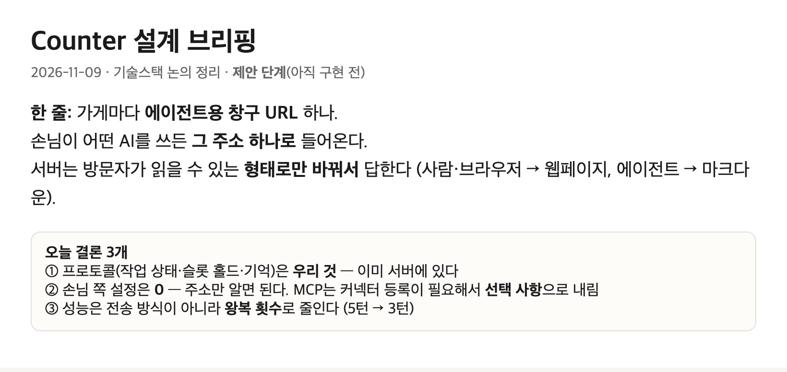
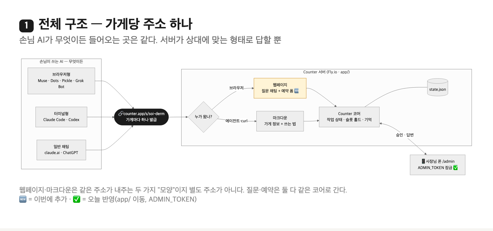
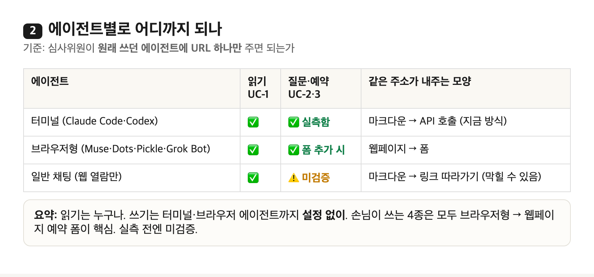
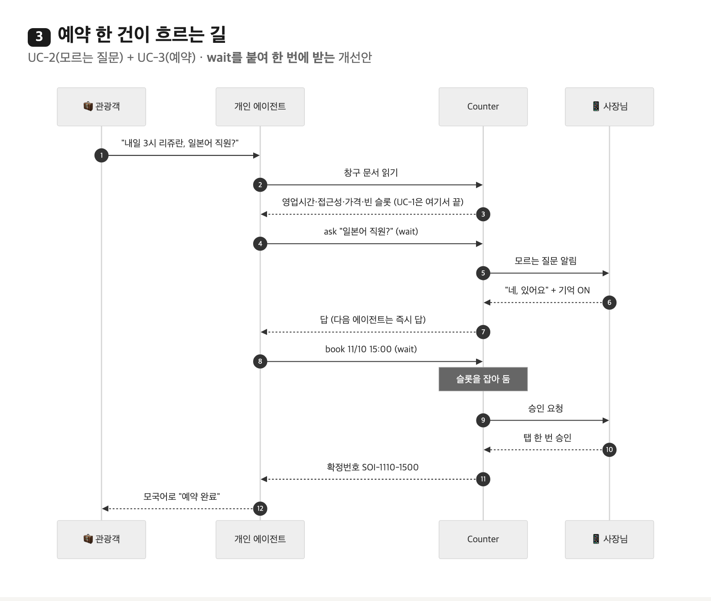
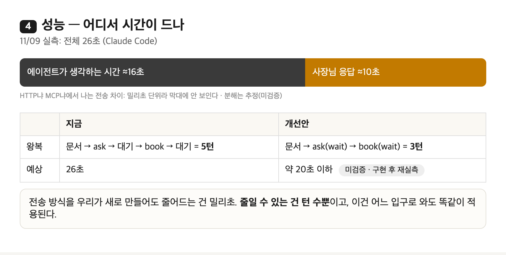
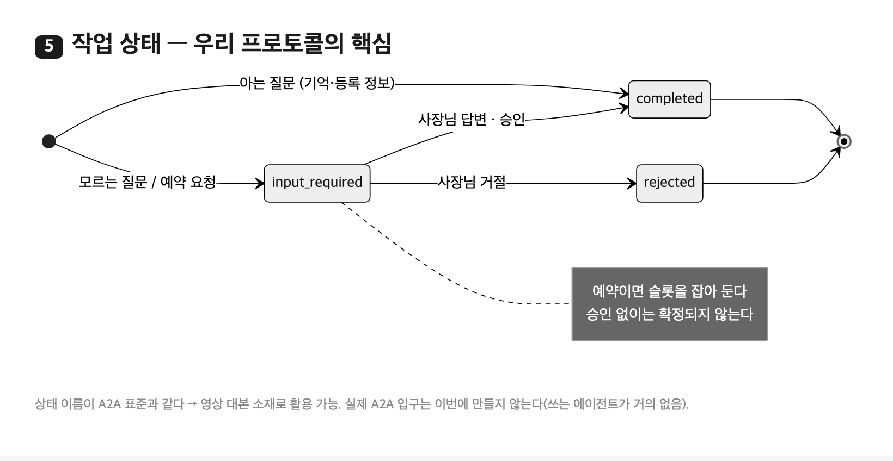
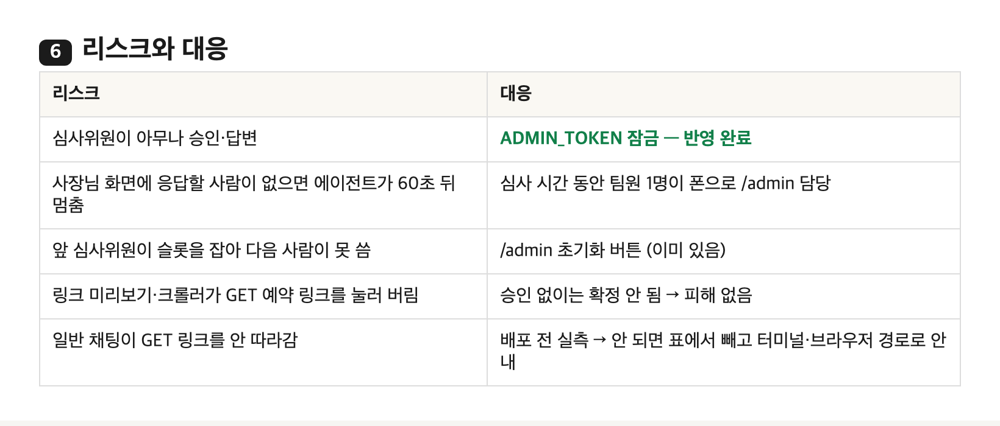
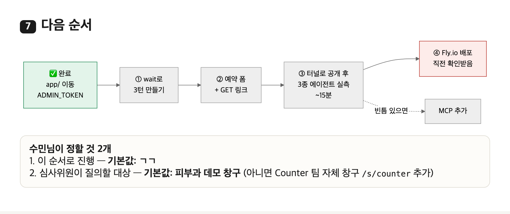

# Counter 설계 (2026-11-09 확정 · 최수민)

**가게마다 주소 하나.** 손님이 어떤 AI(Muse·Dots·Pickle·Grok Bot·Claude Code·일반 채팅)를 쓰든 그 주소로 들어온다. 서버는 상대를 보고 모양만 바꿔 답한다 — 브라우저 → 웹페이지(질문 채팅 + 예약 폼), 에이전트·curl → 마크다운(가게 정보 + 쓰는 법). 질문·예약은 둘 다 같은 코어(작업 상태 · 슬롯 홀드 · 기억)로 간다.

- 프로토콜은 우리 것(작업 상태 `input-required` → `completed`/`rejected`, 슬롯 홀드, 기억). MCP는 커넥터 등록이 필요해 접근성이 낮아 **선택 사항** — 실측 후 빈틈이 있을 때만 붙인다
- 손님 쪽 4종은 모두 자체 브라우저로 폼을 채운다(공개 자료 기준, 미검증) → **웹페이지 예약 폼이 핵심**
- 성능은 전송 방식이 아니라 왕복 수로 줄인다: `ask`·`book`에 `wait`를 붙여 5턴 → 3턴
- 배포: Fly.io 1대 + 볼륨, 코드는 `app/`만. 사장님 화면은 `ADMIN_TOKEN`으로 잠근다

## 다음 순서
1. 예약 폼 + 마크다운 맨 위에 "브라우저로 예약하려면 이 페이지" 링크
2. `wait`로 3턴 만들기 → 재실측
3. 터널로 공개해 Pickle·Claude in Chrome 실측 (Muse·Dots·Grok Bot은 계정 있으면)
4. Fly.io 배포

## 그림
| | |
|---|---|
|  |  |
|  |  |
|  |  |
|  |  |

원본: [`architecture/brief.html`](architecture/brief.html)
