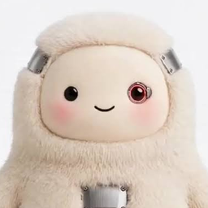

# 캐릭터 시트

영상·데모에 나오는 인물과 에이전트. 이름·생김새·색을 바꾸려면 싱크에서 정하고 여기를 고친다.
시나리오 근거: [데모 시나리오·영상 흐름 회의](../../docs/meeting-logs/261109_후속-데모시나리오-영상흐름회의.md)

## Counter (우리 제품 — 가게 쪽 에이전트)

- 생김새: 파란 털 몬스터 (전신: [`counter-full.png`](characters/counter-full.png))
- 색: 파랑 `#1D78C6`
- 한 줄: "Phones are for people. Counter is for agents." / "An agent at every front desk."
- 성격·말투: TBD
- ⚠️ 임시 이미지. 원본에 Vecteezy 워터마크가 있어 최종 영상 전에 라이선스 구매 또는 교체가 필요하다

## 개인 에이전트 (손님 쪽) — 색: 보라 `#6B4FD8`

| 에이전트 | 이미지 | 장면 | 손님 언어 |
|---|---|---|---|
| Muse |  | 피부과 예약 | 영어 |
| Pickle | 없음 — TBD | 식당 예약 | 중국어 |
| Grok Bot |  | 숙소 예약 | 베트남어 |
| Dots |  | (미배정) | |

- Pickle CEO가 심사위원이다 → 개인 에이전트는 **Counter가 돕는 대상**으로 그린다. 깎아내리지 않는다

## 사람

| 이름 | 역할 | 장면 | 비고 |
|---|---|---|---|
| Yuki Tanaka | 일본인 관광객, Muse 사용자 | 피부과 | 데모 기준 인물(휠체어 사용 → 접근성 질문). 회의에서 정한 피부과 장면 언어(영어)와 맞춰야 함 — TBD |
| 피부과 원장 | Soi Dermatology(명동) | 피부과 | 폰으로 예약 승인·질문 답변 |
| 식당 사장님 | 바쁜 식당 | 문제 제기 | AI 전화가 쏟아져 짜증 |
| 식당 손님 | Pickle 사용자 | 식당 | TBD |
| 숙소 손님 | Grok 사용자 | 숙소 | TBD |
